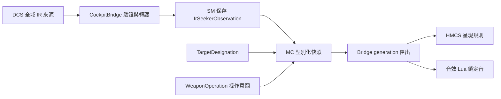

# IR 觀測整理與功能移除報告

日期：2026-11-11。來源基準：`3818a41a38eba1c25141e68d241b56b1ecacf510`。

本輪將武器來源觀測交由 SM 保存，座艙依 MC 發布的狀態呈現與播放音效，移除 FC 內的 InfraredMissileSupport。
使用者已同意一併修正原型提示行為；此變更包含功能移除，而非只搬移原有演算法。

## 移除的功能

| 原有功能 | 原先行為 | 本輪結果 |
|---|---|---|
| 雷達距離推導 IR 鎖定 | 解籠且 STT 距離大於 1 m 時，產生 locked | 鎖定採來源 IrLock 回報 |
| 全零觀測回退 | 解籠產生接觸，指定意圖產生鎖定 | 有效全零觀測維持有效、未鎖定 |
| 非零角度推導接觸 | IR 目標角度或要求角度超過門檻時，產生 contact | 接觸欄位及推導移除 |
| telemetry_active 分支 | 加總多個 IR／雷達欄位，選擇替代推導 | 分支與非零數值門檻移除 |
| Cool／Ready／Track 備便推導 | 依模式、數量、解籠及指定意圖產生狀態 | 備便／冷卻欄位及推導移除 |
| 搜索／追蹤狀態推導 | 由上述備便或 locked 產生 SearchCaged／SearchUncaged／Track | 該尋標狀態欄位及推導移除 |
| WeaponActive 綜合旗標 | 用空對空模式與全部 AAM 數量決定啟用 | SM 保存來源觀測；模式、使用資格及呈現各由既有責任位置管理 |
| MC 自動音調要求 | C++ 產生 Off／Seek／Acquire／Lock | 音效 Lua 依有效 IR lock 決定鎖定音 |
| 自動搜索音與捕獲音 | 原型 Seek／Acquire 會自動播放 | 自動播放及對應資源建立移除；手動 Sound Test 保留 |
| IR lock_range_m | 把雷達 STT 距離複製為 IR 鎖定距離 | 距離保留在目標／雷達觀測 |
| IR 讀取群組的 WS_TARGET_RANGE | 該範圍讀取參與整組 IR 有效性判斷 | 從 IrSeekerObservation、Bridge 讀取及來源目錄移除 |
| FC 內的 IR 支援模組 | 持有模式、庫存、指定意圖、操作及觀測參照 | 類別、兩個來源檔、資料分區與更新呼叫移除 |

接觸、冷卻完成及備便目前沒有獨立來源，公開契約中移除這些衍生欄位。
來源不可用時以 availability 表達未知；數值零與不可用分別處理。

MC 負責音效所需的武器狀態與轉換規則，駕駛艙儀表負責播放。
本輪保留有效來源 lock 對應的鎖定音；搜索／捕獲提示狀態與音效的後續工作記錄於
[Issue #36](https://github.com/jjjjj103074/F-CK-1C/issues/36)，待另行討論與實作。

## 目前資料與職責

| 位置 | 責任 |
|---|---|
| TargetDesignation | 目標指定意圖與雷達追蹤資料 |
| WeaponOperation | 解籠操作意圖、使用資格及開始／結束要求 |
| CockpitBridge | 驗證並轉譯 IR lock、要求方向及目標方向 |
| StoresManagement | 唯一寫入 StoresData.ir_seeker，保存當前全域來源觀測 |
| MissionComputer | 將 SM 觀測與火控意圖組成型別化快照 |
| MissionComputerExporter | 在完整 generation 內匯出觀測、可用性、來源版本與失效原因 |
| hmcs_system.lua | 依模式、操作意圖、有效 lock 及既有偏好決定武器呈現 |
| aam_audio_system.lua | 依完整快照的有效 lock 決定鎖定音與播放 |

來源目前沒有掛點識別。SM 將觀測保存為全域武器介面資料，掛點庫存與所選掛點各自保存。
要求方向與來源回報的目標方向各自保留；此資料沒有新增每顆飛彈、冷卻或導引模型。
MC 頂層維持八個元件；DFLCC、SM 的選站／執行規則及 TargetDesignation／WeaponOperation 分工維持原設計。

## 座艙契約與可見行為

- `McMissileUncageHeld` 取代 `Aim9UncageHeld`，仍表示駕駛操作意圖。
- `McStoresAirToAirMissileCount` 取代 `Aim9MissileCount`，數量與完整性仍來自 SM。
- 新增 `McStoresIrSeekerAvailable`、`Revision`、`InvalidReason`、`Lock`，以及要求／目標方向欄位。
- 舊 AIM9 備便、接觸、啟用、尋標狀態、音調與距離欄位及未使用的 RequestedTone／TargetDesignated 匯出移除。
  目標指定仍存在 FireControlSnapshot.target_designation。
- HMCS 使用有效 lock，移除原型 contact／readiness 對武器類別的影響。原按鍵、模式、解籠及操作偏好規則保留。
- 鎖定音只由有效的來源 lock 啟動；單獨雷達鎖定、指定目標或解籠不會合成鎖定音。
- 音效保留既有 ToneHi 資源。來源／MC 不可用、奇數 generation 或讀取中 generation 變動時，鎖定音停止。
- DCS 發射命令、機砲、投放保持、主保險、選站及彈量計算維持既有流程。

## 驗證

驗證執行實際 MC／SM、Bridge／Exporter 及 Lua 腳本。Bridge／Exporter 的 Linux 相容建置
僅在暫存副本提供 Windows 模組查詢 stub，並將生成表的字串宣告改為 constexpr；
專案 SDK、產生器與生成檔維持原本格式，欄位名稱與數值不變。
座艙檢查在暫存控制器使用平台路徑分隔符；專案檢查器維持原版。

| 檢查 | 結果 |
|---|---|
| Linux C++ MC／SM／模式／原生讀取回歸 | 964 項，0 失敗 |
| Linux 相容 Bridge／Exporter 回歸 | 270 項，0 失敗 |
| Lua 5.1.5 實際介面、HMCS、音效與按鍵回歸 | 6,195 項，0 失敗 |
| C++ 排版 | 296 個檔案通過 |
| EFM 架構 | 258 個來源通過 |
| 座艙架構 | 123 個自訂參數、16 個原生參數通過 |
| DCS ID 產生器回歸與重複生成 | 通過 |
| 座艙架構檢查器回歸 | 通過 |

回歸涵蓋有效全零、來源失效與恢復、不同模式／保險／空載下的觀測、
要求／目標角度分離、來源隔離、匯出有效性與 generation，以及音效和 HMCS 的有效性處理。

來源先經本機驗證與雙軸 code-review，再提交至 Windows CI，以固定工具鏈完成重建與完整驗證。
經來源版本及雜湊核對的 DLL 另作產物提交；DCS 遊戲驗證獨立記錄。
DCS 測試使用同一版本的 DLL、Lua 與生成參數。
