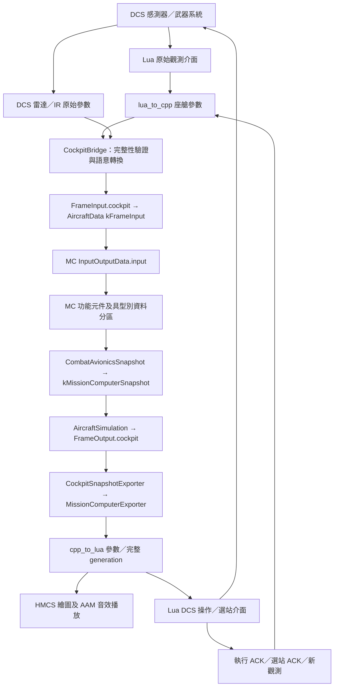
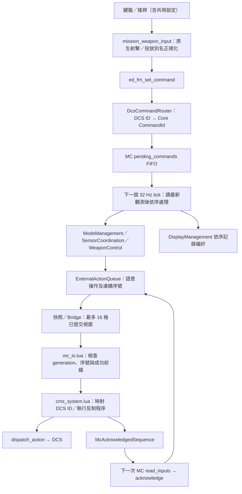

# MC 遷移變更報告

本報告描述 `mission-computer` 分支的實作，以及此次確認的四項結論。
遷移比較起點為 `8fda92d`（模組化 EFM 基礎），不把該起點之前的 DFLCC 功能算成本次 MC 變更。
這是 DCS 專案架構，不宣稱復刻實機 F-CK-1C、F-16 MMC 或 F-35 的完整內部設計。

## 已確認的設計

| 項目 | 結論與目前實作 |
|---|---|
| 更新頻率 | MC 外層及全部週期工作採 32 Hz，即 31.25 ms；DFLCC 保持 64 Hz |
| 數量 API | 保留原有 `get_base_data()` 候選函數、順序及有效性檢查；依使用者先前正常運作的經驗維持使用，待 DCS 實測各名稱與回傳語意 |
| 模式及操作行為 | 維持原 Lua 的模式、Master Arm、uncage、最短保持及自動鎖定規則；已遷移的判斷在 C++ MC 執行 |
| 射擊／投放入口 | 自訂 MC 命令及鍵盤／搖桿原生開火／投放別名都送入 MC；核准後才由 Lua 呼叫 DCS |
| 電源及備援 | 不實作冷啟動、斷電恢復、故障處置或冗餘切換 |

32 Hz 參考 [SEI 簡報 PDF 第 20 頁](https://www.sei.cmu.edu/documents/3306/2012_017_001_24084.pdf#page=20)
傳統任務航電的約 20–40 Hz 範例，是本專案的選擇，不是已知 F-16 MMC／F-CK-1C 頻率。
32 Hz 不表示所有 DCS 觀測同時更新，也不保證端到端動作延遲只有 31.25 ms。

## 變更範圍

| 部分 | 具體變更 |
|---|---|
| MC 組裝 | 新增單一 System、直接持有元件與資料庫、固定參照、單一 Executive，以及 `mission_computer` 登記 |
| 模式與 HOTAS | Lua 中的 Master Arm、NAV／DGFT／MSL、TMS、uncage、扳機／投放資格及操作計時移入 C++ |
| 掛載管理 | Lua 僅送原始七站資料並執行選站；分類、數量來源、耗盡與再裝填後選站由 MC 決定 |
| 尋標與顯示 | IR／雷達觀測推導、AIM-9 readiness／contact／lock／tone，以及武器顯示類別與數量移入 MC |
| 指令傳遞 | 新增語意操作 FIFO、16 格傳遞視窗、連續序號及成功前綴 ACK，保留同 tick 中間操作 |
| Bridge／契約 | 新增型別化觀測及快照、原始掛點驗證、DCS 分類轉譯、MC 快照與參數輸出 |
| 輸入設定 | MC/HOTAS 命令改走 EFM；原生射擊／投放別名轉成 MC 命令，合併重複項並保留按鍵組合 |
| 排程 | MC 使用獨立 32 Hz 常數，沒有修改 DFLCC 頻率或其功能元件 |
| 工具與 CI | 新增分段 Windows 驗證、固定工具鏈安裝與分析修正、來源／DLL 收據；更新產生器與架構檢查器 |
| 回歸驗證 | 新增 MC 原生、Bridge 及 Lua 測試，覆蓋排程、操作順序、觀測完整性、選站、尋標、顯示與輸入別名 |
| 本次補完 | 修正座艙及貢獻指南的舊責任說明；新增數量 API 成功／零值／失敗後續讀測試及 DCS 驗收表；未改執行期判斷 |

主要功能提交：`329eadc`（骨架）、`4c307d0`（模式／HOTAS）、`784281d`（掛載）、
`6a11d88`（尋標／顯示）、`a3bfa77`（32 Hz）、`8136459`（原生射擊／投放入口）。
中間的工具修正及產物收據保留在分支歷史中。

## 目前架構

MC 有 **6 個任務功能元件 + 4 個基礎元件，共 10 個同層元件**。
它們不是 10 個 System 或執行緒，而是單一 `MissionComputer : System` 直接持有的物件。
內部邏輯依責任分元件；同一責任下的演算法、狀態及小工具留在該元件內。

```text
SystemPipeline
└── MissionComputer : System [32 Hz]
    ├── Database/（先於元件建立）
    │   ├── ExecutiveTables
    │   ├── InputOutputData
    │   ├── SystemStatusTables
    │   ├── MissionData.h
    │   │   └── ModeData / SensorData / StoresData / WeaponControlData /
    │   │       Aim9Data / WeaponDisplayData
    │   └── ExternalActionQueue
    └── Components/（固定參照、單一 Executive）
        ├── ModeManagement
        ├── StoresManagement
        ├── WeaponControl
        ├── SensorCoordination
        ├── Aim9SeekerProcessing
        ├── DisplayManagement
        ├── Executive
        ├── StartupAndRestart
        ├── SystemMonitor
        └── FailureManager
```

| 元件 | 責任 | 執行方式 |
|---|---|---|
| ModeManagement | Master Arm、主模式、模式變更協調及反制啟停資格 | FIFO 命令事件 |
| StoresManagement | 分類、數量來源／估算、選站要求、耗盡／再裝填後選站 | 32 Hz，另有投放數量更新入口 |
| WeaponControl | 扳機／投放資格、最短保持、停止操作 | 命令事件及 32 Hz |
| SensorCoordination | TMS、uncage、子模式、目標指定、DGFT 自動鎖定要求 | 命令事件及 32 Hz |
| Aim9SeekerProcessing | 原有 IR／雷達推導、readiness、contact／lock 及 tone 要求 | 32 Hz |
| DisplayManagement | 依序記錄命令偏好，產生最終武器類別／數量 | 觀察每筆命令及 32 Hz |
| Executive | 固定任務表、到期順序、時間前進及補跑 | MC tick 呼叫 |
| StartupAndRestart | 建構時啟用 Executive | 目前僅此功能 |
| SystemMonitor | 預留健康監控 | 32 Hz 空入口 |
| FailureManager | 預留故障處置 | 32 Hz 空入口 |

ModeManagement 經固定參照協調 WeaponControl／SensorCoordination；WeaponControl 可要求
SensorCoordination 準備投放／解除指定，以及 StoresManagement 更新估計數量。
這些是同一台 MC 內的協作；沒有跨 System 呼叫另一台電腦的內部元件。
MC 外殼負責組裝、接線、命令分派與快照投影。

### 與 DFLCC 的對齊

沿用單一 System、資料庫先建立、固定參照、單一 Executive 及同時到期依任務表順序執行。
MC、Executive、ExecutiveTables 不可複製或搬移，確保已綁定參照的地址穩定。
功能元件依 MC 的責任命名，不複製 DFLCC 的 ControlLaws／AmuxProcessor 等飛控職責。
32 Hz 不影響組裝方式；本次不需要改 DFLCC。
兩台電腦的排程實作仍分開，尚未抽成泛用框架。

## 資料庫與權責

資料庫是 MC 內的具型別記憶體結構，不是 SQL、磁碟資料庫或跨電腦共享可寫物件。
`MissionData.h` 宣告六個獨立資料分區；連同其餘四組，共由 MC 直接持有十個資料物件。

| 分區 | 寫入權責 | 內容／使用者 |
|---|---|---|
| ExecutiveTables | Executive | 固定工作設定、完成 tick 數、下次到期時間 |
| InputOutputData.input | MC 命令入口與 read_inputs／consume_commands | 最新 CockpitObservation、觀測時間及待處理 FIFO；供功能元件讀取 |
| InputOutputData.output | MC publish_outputs | CombatAvionicsSnapshot；交給 Pipeline／Bridge |
| SystemStatusTables | 對應基礎元件 | lifecycle／health／failure_response，尚無功能狀態 |
| ModeData | ModeManagement | Master Arm 與主模式 |
| SensorData | SensorCoordination | 子模式、uncage、目標指定 |
| StoresData | StoresManagement | 飛彈／機炮數量、飛彈數量來源、已確認選站與要求 revision |
| WeaponControlData | WeaponControl | 已接受 gun／pickle 要求、GunOn 身分及開火指示 |
| Aim9Data | Aim9SeekerProcessing | readiness、active、contact、lock、tone、尋標角及距離 |
| WeaponDisplayData | DisplayManagement | 偏好類別、扳機顯示狀態、最終類別與數量 |
| ExternalActionQueue | 元件追加；MC 確認與取視窗 | 尚未確認的語意操作、序號及已發布界線；本身不決定武器資格 |

## 資料流



| 來源 | 取樣／更新 | MC 如何使用 |
|---|---|---|
| weapon_system.lua | 20 Hz | 七站 present、count、原生分類、CLSID，經 Bridge 轉為 WeaponStationObservation |
| cms_system.lua | 50 Hz | 既有 get_base_data 數量、操作介面可用性、操作 ACK；雷達開啟狀態另由參數讀入 |
| DCS radar／IR 參數 | 由 DCS 模型更新，Bridge 取當前觀測 | RadarObservation／IrSeekerObservation，推導尋標狀態 |
| hmcs_system.lua | 64 Hz | 原始磁航向／氣壓高度送 Bridge；HMCS 自身的 IAS／高度／航向呈現保留在 Lua |
| MC | 32 Hz | 使用最新可取得觀測；不把 20 Hz 掛點資料宣稱成 32 Hz 新樣本 |
| aam_audio_system.lua | 20 Hz | 讀取 MC tone 要求並播放，不再自行判定接觸／鎖定 |

### 掛載與彈量

1. Lua 呼叫 `get_station_info(0..6)`，發布七筆原始紀錄。
2. 每筆為 `present;count;level2;level3;identifier`。這是座艙參數邊界序列化；
   Bridge 只切前四個分號，CLSID 內的分號保留，進入 Core 後是具型別結構。
3. Lua 發布奇／偶 revision；Bridge 讀前後須同為正偶數且相同，七筆皆合法才接受整份清單。
   API 錯誤或半份更新不作新觀測；成功回傳空站／零枚則是有效資料。
4. Bridge 把原生 wsType 轉為 WeaponCategory／WeaponRole；Core 不依賴 DCS ID。
5. StoresManagement 的飛彈數量優先序為：有效七站清單 → 既有總數 API → 估計。
   機炮優先用自己的數量 API；沒有有效來源才沿用原有 523 發／100 發每秒估計。
6. 飛彈估計從原有一枚或最後有效數量延續，僅於估計來源時依完成的投放操作遞減。
   機炮估計依 MC 接受的開火要求延續，不因被拒絕的扳機扣數；兩者都不是 DCS 發射數的實測。

C++ 已能取得所需掛點資料，但目前附帶 EFM C++ SDK 沒有對等完整掛點查詢入口，
所以 DCS 資料入口仍經 Lua。數量候選 API 保留既有名稱及順序，沒有將其不存在視為已知缺陷。
`getAmmoCount` 等名稱的武器範圍／單位也沒有重新解釋；等待 DCS 驗證後才決定是否調整。

### 選站要求與回饋

MC 在 AAM 模式選第一個仍有彈的合格站；模式切換、耗盡及再裝填可產生新要求。
`requested_station + selection_request_revision` 經參數送 Lua；Lua 呼叫 `select_station()` 成功後回 ACK。
MC 接受符合要求的 ACK，才更新 `selected_station`。
它表示最後成功執行的要求，不是 DCS 實際物理選站的讀回。
NAV 的空要求只清除介面紀錄；目前 SDK 沒有對應 deselect 呼叫。

## 指令流



這張圖描述 MC 與射擊／投放入口；既有直接模式、感測器及反制測試入口仍保留。
MC 共登記 19 個命令入口，含三個預留項目：

| 類別 | 入口 | 處理者 |
|---|---|---|
| 主模式／武裝 | Master ON／OFF／SIM、NAV／DGFT／MSL | ModeManagement |
| 反制 | Forward／Aft／Left、Right、Press | ModeManagement；Right 中止，Press 預留 |
| 扳機 | 第一段、第二段 | 第一段預留；第二段由 WeaponControl |
| 投放 | WeaponRelease | WeaponControl |
| 尋標／指定 | Uncage、TMS Up／Down／Left／Right | SensorCoordination；TMS Left 預留 |

按下／放開傳 1／0；連續按住的原生別名轉成一次按下及放開，MC 維持已接受的要求。
別名與既有 MC 項目合併，保留 Space、RAlt+Space、JOY_BTN1／2 等原有組合。
輸入正規化不刪除下游 DCS actuation ID，也不改其他測試命令。

### 時間及傳遞規則

每個 MC tick：`read_inputs → consume_commands → Executive::step → publish_outputs`。
同時到期順序：StoresManagement → WeaponControl → SensorCoordination →
Aim9SeekerProcessing → DisplayManagement → SystemMonitor → FailureManager。
ModeManagement 只有事件入口，因此 **10 個元件對應 7 個週期工作**。

- 同一 tick 的 OFF → ON 等多筆命令保留 FIFO 中間操作，不只留下最後狀態。
- gun／pickle／lock 的正常放開沿用 80 ms 最短保持；由 MC 觀測到 Lua 執行 ACK 的當前時間起算。
- Master OFF／SIM 在命令消費時追加停止，不等待保持期；DCS 實際收到停止仍需後續 Lua 更新。
- DGFT 自動鎖定沿用 1 秒間隔；補跑不把新的觀測／按鍵倒填為過去動作。
- 序號未確認則保留；每次發布最多 16 筆。Lua 只確認連續、成功的前綴，失敗後重試。
- 奇數 generation 代表寫入中，完整寫完才提交偶數；缺參數或讀取中變更不可消費。
- 成功已確認的操作不重播；DCS 呼叫本身沒有交易或恰好一次保證。

## 保留的行為與邊界

- DGFT／MSL 仍會使 Master ON；NAV 不新增強制停止已開始操作的規則。這些耦合留待後續設計討論。
- 機炮 gate 仍是 Master ON + DGFT + 未 uncage；投放仍是 Master ON + AAM 模式 + uncage，另需操作介面可用。
- AIM-9 contact／lock 優先使用直接 IR 觀測；其他 IR／雷達推導及有效全零回退保留舊原型規則。
  缺失觀測不偽裝為有效全零；readiness 是命令狀態，不等同實測鎖定。
- 顯示偏好可受被拒絕的扳機影響，以維持舊顯示行為；顯示不是開火權威。
- 反制次數、間隔、配對排程及執行中互鎖仍在 CMS；MC 決定啟動資格與中止要求。
- DCS 雷達／武器模型、繪圖頁與播放資源保留；沒有新增彈道、導引、實體匯流排或 RIU 模擬。
- CombatAvionicsSnapshot 的 radar／countermeasures 預留快照尚未成為可用完整狀態，不能據此宣稱已有雷達管理或反制庫存功能。
- `set_powered(bool)` 僅為骨架測試開關；不支援飛行中斷電恢復及備援。

## 驗證與產物

此前執行期來源 `8136459` 的 [Windows CI 40466546850](https://github.com/jjjjj103074/F-CK-1C/actions/runs/40466546850)
已通過 16 項完整驗證、3,591 個 C++ checks、89 個 Node tests 及 660 個 Lua checks。
本次增加既有數量 API 成功路徑等測試後，本機 Lua 5.1.5 為 **695 checks、0 failures**。
它驗證實際 Lua 介面的契約，沒有證明 DCS 物件提供哪些函數。

每段先 Standards／Spec 審查及本機測試，再 commit／push，然後以固定 Windows 工具鏈
重建並執行完整 `validate_efm.ps1`。成功後核對 artifact ZIP、來源 commit／tree、
DLL SHA256 及重建結果，再另作產物／收據 commit。
最新來源及 CI run 以 [DLL 驗證收據](../bin/F-CK-1C_EFM.validation.json) 為準；
收據 commit 與它驗證的來源 commit 本來就不同，避免收據自我參照。

測試入口：

- [MC 原生測試](../src/efm/F-CK-1C_EFM_Tests/MissionComputerTests.cpp)：32 Hz、FIFO、短按、ACK、補跑、選站、數量、尋標及顯示。
- [CockpitBridge 測試](../src/efm/F-CK-1C_EFM_Tests/CockpitBridgeTests.cpp)：邊界觀測、有效性及完整 revision。
- [快照輸出測試](../src/efm/F-CK-1C_EFM_Tests/CockpitSnapshotExporterTests.cpp)：參數輸出與不完整提交。
- [Lua 5.1 測試](../tools/test_mc_lua.lua)：真實介面、API fixture、操作視窗、選站及兩份實際輸入設定。
- [Windows workflow](../.github/workflows/mc-windows-validation.yml)：Lua、格式、工具測試、DLL、完整 Windows 驗證與證據。

DCS 遊戲內驗證尚未執行，依 [DCS MC 驗收表](DCS_TESTING.md#mc-遷移驗證尚待-dcs-執行)
核對函數、掛載、gate、輸入、延遲、選站、音效及任務重入。

## 主要閱讀入口

| 目的 | 檔案 |
|---|---|
| 組裝與任務表 | [MissionComputer.cpp](../src/efm/F-CK-1C_EFM/Core/Systems/MissionComputer/MissionComputer.cpp) |
| 組裝規則及所有權 | [MC README](../src/efm/F-CK-1C_EFM/Core/Systems/MissionComputer/README.md) |
| 功能狀態 | [MissionData.h](../src/efm/F-CK-1C_EFM/Core/Systems/MissionComputer/Database/MissionData.h) |
| 對外型別 | [CockpitContracts.h](../src/efm/F-CK-1C_EFM/Core/Contracts/CockpitContracts.h) |
| 語意操作 | [MissionActions.h](../src/efm/F-CK-1C_EFM/Core/Contracts/MissionActions.h) |
| 原始觀測轉換 | [CockpitBridge.cpp](../src/efm/F-CK-1C_EFM/DcsBridge/Internal/CockpitBridge.cpp) |
| MC 參數輸出 | [MissionComputerExporter.cpp](../src/efm/F-CK-1C_EFM/DcsBridge/Internal/MissionComputerExporter.cpp) |
| 原生輸入正規化 | [mission_weapon_input.lua](../Input/F-CK-1C/mission_weapon_input.lua) |
| Lua 保留責任 | [座艙指南](COCKPIT.md) |
