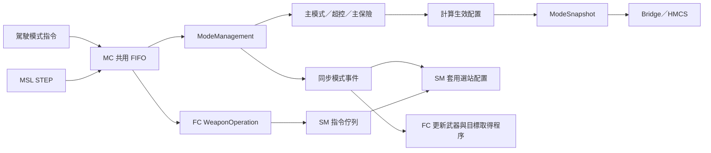

# MC 模式狀態與同步事件

ModeManagement 是模式資料的唯一寫入者，管理一般主模式、空戰超控與主保險。
本專案以 F-16 的模式切換操作作參考，狀態機與資料結構由本專案實作。

## 模式與資料所有權

| 資料 | 值 | 功能 |
|---|---|---|
| `ModeData.master_mode` | NAV／A-A／A-G | 保存一般任務情境，超控期間保留原選擇 |
| `ModeData.override_mode` | None／Dogfight／Missile | 保存三段超控開關位置 |
| `ModeData.master_arm` | OFF／SIM／ON | 保存獨立的軟體主保險狀態 |
| `ModeData.operating_mode()` | NAV／DGFT／MSL／A-A／A-G | 由主模式及超控位置計算目前生效配置 |

模式資料由 MC 持有，其他元件取得 const 參照。生效配置即時計算，切換與恢復規則集中在
ModeManagement。頂層元件數量維持原狀。

## 操作規則

- 超控在中央位置時，A-A／A-G 按鈕切換到指定主模式；重按目前 A-A／A-G 按鈕回 NAV。
- NAV 指令選擇 NAV。超控期間，NAV／A-A／A-G 指令保持原選擇。
- 選 DGFT 或 MSL 會保留原主模式並套用超控配置；兩個超控可互相切換。
- 選中央位置解除超控，恢復保存的一般主模式。
- 重選同一超控位置保持狀態、掛點與目標取得設定。
- MSL STEP 是獨立武器操作，FC 在空對空配置將輪站要求送入 SM 佇列，SM 決定下一個可用掛點。
- 主保險與模式各自選擇；SAFE／SIM 的武器中止順序沿用既有事件機制。

## 職責與同步通知

ModeManagement 依賴 ModeData、ModeEvents 與語意指令。MC 集中組裝 scoped_connection。
每筆 FIFO 指令及同步回呼完成後，才處理下一筆指令。

`OperatingModeSelected` 保存選擇前後的完整 ModeData 副本。模式回呼依 group 先通知 SM，
再通知 FC。主模式或超控的有效切換會結束先前配置的武器操作，再更新目標取得設定。
武器輪站透過獨立的 MSL STEP 指令處理。

`MasterArmSelected` 也保存前後副本；OFF／SIM 先通知 FC 停止，再通知 CMS 中止。
各台 MC 持有自己的事件通道及連線，回呼生命週期由 MC 組裝管理。

事件使用 `ThirdParty/sigslot` v1.2.3 的 `signal_st` 與 scoped_connection。
版本、SHA 與授權保存在第三方目錄的 README。跨 System 仍使用 SystemPipeline 資料契約。

## 對外快照與座艙契約

`CombatAvionicsSnapshot.mode` 同時發布保存的主模式、超控位置與生效配置。
Bridge 以原有 MC generation 一起提交所有數值：

| 參數 | 數值 |
|---|---|
| `MC_MASTER_MODE` | NAV=0、A-A=1、A-G=2 |
| `MC_OVERRIDE_MODE` | 中央=0、DGFT=1、MSL=2 |
| `HMCS_FC_MODE` | NAV=0、DGFT=1、MSL=2、A-A=3、A-G=4 |
| `HMCS_MASTER_MODE` | 主保險 OFF=0、SIM=1、ON=2（沿用既有名稱） |

HMCS 的 MODE 顯示目前生效的 NAV／DGF／MSL／A-A／A-G。
一般 A-A 沿用現有飛彈選站與 BVR 目標取得流程；DGFT 保留既有機砲及飛彈操作。
A-G 這輪提供狀態與切換架構，對地武器使用及雷達模式待後續實作。

## DCS 指令

| 操作 | 預設鍵／控制選項 |
|---|---|
| NAV | `1`；超控中央位置時生效 |
| DGFT | `右 Ctrl + D` |
| MSL OVRD | `右 Alt + D` |
| A-A | `2`；Master Mode Button - A-A (Toggle to NAV) |
| A-G | `3`；Master Mode Button - A-G (Toggle to NAV) |
| 超控中央位置 | `右 Shift + D`；Dogfight Switch - CENTER (Restore Master Mode) |
| 輪站 | `Q`；短按同型輪站、按住達 0.5 秒切換武器型別 |

進入超控後，使用中央位置指令回復原主模式。NAV 的 `1` 對應主模式選擇，
因此超控期間保持目前配置。MSL STEP 的型別與輸入處理見 [MC 操作說明](MC_CONTROLS.zh-TW.md)。

## 驗證

模式測試涵蓋所有主模式的超控進入、DGFT／MSL 互換、中央復歸、重選保持、
主模式按鈕切換與超控期間的按鈕處理、主保險獨立性、事件副本、通知順序及實例隔離。
MC 整合回歸涵蓋 SM 選站、獨立輪站、A-G 使用資格、輸出快照與指令 FIFO。
Bridge／Lua 回歸核對新數值及輸入路由。

原 sigslot 事件重構的 Windows 與 DLL 證據見 [歷史驗證紀錄](MC_MODE_EVENTS_VALIDATION.md)。
本輪來源與 DLL／DCS 執行期驗證分別記錄。

### 本輪來源驗證（2026-11-17）

| 項目 | 結果 |
|---|---|
| Linux C++17 模式、MC、SM、RadarSystem、指令路由 | 1,489 checks，0 failures |
| Linux 相容模式座艙快照輸出 | 162 checks，0 failures |
| Lua 5.1.5 介面與顯示回歸 | 6,237 checks，0 failures |
| C++ 排版 | 319 個檔案通過 |
| DCS ID 產生器回歸 | 通過 |
| EFM 架構 | 276 個來源檔通過 |
| 座艙架構 | 134 個自訂參數、16 個原生參數通過 |
| Recorder／indicator／反制按鍵 fixture | 通過 |
| Windows 指定工具鏈完整驗證與 DLL 重建 | 通過；4,965 checks，0 failures；來源 `ee1db575` |
| DCS 實機 | 待執行 |

Linux 原生測試使用 g++ C++17、O0、Wall／Wextra／Werror／pedantic。
座艙輸出測試使用暫存 Windows API stub，並在相容副本將既有產生表的字串常數改為 constexpr；
來源產生器及 SDK 保持原樣。座艙架構清單使用暫存 Linux 路徑轉接產生，再交由專案檢查器檢查。
Windows CI 已依指定工具鏈重建 DLL，並通過完整專案驗證；產物與來源憑證位於 bin。
[CI 驗證紀錄](https://github.com/jjjjj103074/F-CK-1C/actions/runs/44035007396)對應來源 `ee1db5757872d8d002596444737ad92555977c0f`。
DCS 遊戲內操作另行驗證。
