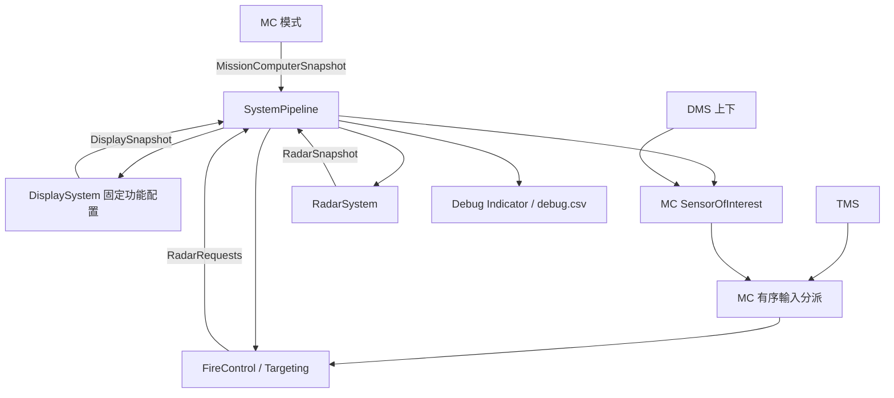

# 顯示功能、SOI 與 TMS

## 依據與本輪範圍

SOI／既有 HOTAS 介面依據為 Lockheed Martin 的真實飛機手冊 **T.O. GR1F-16CJ-34-1-1，HAF F-16C/D Block 50，1997-06-16**。

| 印刷頁碼 | 採用的內容 |
|---|---|
| 1-43～1-47 | HOTAS、獨立游標控制、DMS 與 TMS 各方向的操作 |
| 1-59～1-63 | MFDS、格式選擇、交換與 DMS 左右的格式輪換 |
| 1-70～1-74 | SOI 標記、模式與格式變化、DMS 上下、來源隨頁面交換移動 |

[原始手冊 PDF](https://falcon.blu3wolf.com/Docs/HAF-F16-34.pdf)。本輪沒有採用 DCS 或 BMS 手冊作為飛機操作規範。
這份來源是 1997 年 Block 50 文件；F-CK-1C 的實際軟體配置仍屬獨立問題。

真機的 MFD 格式可以配置。本專案目前由模式固定決定左右功能，這組固定配置是專案設定。
DisplaySystem 發布的是功能與控制來源對應；目前沒有新增實際 MFD 繪圖。

目前雷達實作收斂為 CRM／RWS、ACM／BORE 與原生 STT；掃描參數來源與適用差異見 [雷達模式設定](RADAR_MODES.zh-TW.md)。

## 固定功能配置

| 生效模式 | 左 MFD 功能 | 右 MFD 功能 | 進入模式後的 SOI |
|---|---|---|---|
| NAV | HSD，導航空殼 | SMS | HUD，指定空殼 |
| A-A | FCR | SMS | FCR／左 MFD |
| DGFT | FCR／ACM | SMS | FCR／左 MFD |
| MSL OVRD | FCR／CRM | SMS | FCR／左 MFD |
| A-G | FCR，空地空殼 | SMS | FCR／左 MFD |

SMS 的庫存管理持續由 SM 提供。SMS 頁面在本輪配置中沒有 TMS 控制來源。
HSD 的控制來源為 Navigation，保留指定與資料管理的操作入口；本輪以 debug 回報接收情況。
HUD 在 NAV／A-G 提供指定入口，在空戰模式依手冊限制維持 FCR SOI。

## 職責與資料所有權

| 擁有者 | 寫入內容 | 使用方式 |
|---|---|---|
| DisplaySystem | DisplaySnapshot：模式、左右功能、控制來源、HUD 指定入口與格式輪換要求 | 經 SystemPipeline 發布 |
| MC／SensorOfInterest | SensorOfInterestSnapshot：來源、顯示位置、顯示情境就緒狀態 | 讀取顯示快照與任務模式，處理 DMS 上下 |
| MC 輸入分派 | 有序 TMS 輸入與按住操作的原始接收者 | 將 FCR 輸入交給 FireControl／Targeting；HUD／導航入口記錄為預留 |
| Targeting | 雷達操作策略、TMS 計時、指定意圖 | 提出具型別 RadarRequests |
| RadarSystem | 設備要求結果、操作佇列與原生觀測 | 回報 Native／Simplified／Reserved 及實際 SEARCH／STT |
| SensorControlTelemetry | 可讀的診斷文字與最近操作結果 | 使用原有 Debug Indicator 與 debug.csv |

MC 與 DisplaySystem 各以 32 Hz 經 Pipeline 交換快照。模式改變後，顯示配置於後續 tick 更新；
MC 等待相符的顯示情境再提供 SOI。按住中的輸入保存其接收者，放開時結束同一次操作。
切換模式會結束舊的按住操作；重新按下才啟動新配置的操作。

## 預設按鍵

| 操作 | 預設鍵 |
|---|---|
| NAV／A-A／A-G | 1／2／3 |
| DGFT／CENTER／MSL OVRD | 右 Ctrl＋D／右 Shift＋D／右 Alt＋D |
| 解籠切換／投放 | C／右 Alt＋Space |
| TMS 上／下／左／右 | I／K／J／L |
| DMS 上／下／左／右 | 右 Shift＋I／K／J／L |
| Debug Indicator（測試包） | 右 Ctrl＋右 Shift＋F12 |

TMS 是指定及資料管理控制；游標移動由獨立的原生游標輸入提供。
輸入設定會將共用預設中與 TMS／DMS 相同的組合交給本機控制，其餘組合保留。

## DMS

| 操作 | 本輪行為 |
|---|---|
| 上 | 在 NAV／A-G 選 HUD；空戰模式保持 FCR |
| 下 | 從 HUD 選可用 MFD 來源；在 MFD 上嘗試選另一邊可用來源 |
| 左／右 | 保存對應 MFD 的格式輪換要求；本輪固定頁面配置保持原值 |

來源與顯示位置分開保存。例如 FCR 換到另一個顯示位置時，SOI 跟隨 FCR。

## TMS 與設備實作程度

### CRM：A-A／MSL OVRD

| 操作 | 手冊語意 | 本輪設備端 |
|---|---|---|
| 上按住 | Spotlight 搜尋 | 保存 Spotlight 要求，Reserved；原生搜尋持續運作 |
| 上放開 | 追蹤游標下目標 | 使用既有原生捕獲入口；實際成功由 STT 觀測判定 |
| 下 | 拒絕目標、返回搜尋 | 取消 MC 指定意圖並結束捕獲輸入；原生追蹤狀態持續如實回報 |
| 左 | 展開所選目標資料 RCR | ExpandTargetData 入口，Reserved |
| 右，按住時間至多 1 秒 | 輪選優先目標 | StepPriorityTarget 入口，Reserved |
| 右，按住超過 1 秒 | CRM 搜尋與 TWS 切換 | 保存 RWS／TWS 要求；TWS 為空殼，原生觀測持續回報 SEARCH／STT |

TMS 右以本專節的 **1 秒**為界，與 MSL STEP 的 0.5 秒操作分開。
優先目標輪選與原生的重新換鎖是不同操作；本輪保留真正的輪選入口及預留結果。

### ACM：DGFT

| 操作 | 目標操作策略 | 本輪設備端 |
|---|---|---|
| 進入模式 | BORE 待操作配置 | 寫入機體參考視線的窄區設定 |
| 上，放開 | 啟動 BORE 自動捕獲 | 持續等待目標，成功後以原生 STT 回報 |
| 下 | 拒絕目標、停止自動捕獲 | 保留 BORE，等待下一次明確啟動 |
| 左 | 展開目標資料 | Reserved |
| 右 | 30×20 要求入口 | Reserved，現行配置維持 BORE |

30×20／10×60 尚屬預留。解籠與進入 DGFT 本身維持捕獲待操作；捕獲由 TMS 明確啟動。

### NAV／A-G 的空殼

- HUD／HSD：接收對應 SOI 的 TMS 操作並回報 Reserved，供後續導航與指定功能接入。
- A-G FCR：提供 DesignateGroundTarget、RejectGroundTarget、CycleSightingPoint 要求；設備端回報 Reserved。

本輪維持 SM 的庫存與選站、武器使用資格、主保險獨立、反制程序及機砲／投放的既有分工。

## Debug Indicator 與紀錄

測試包自動為既有 debug 入口提供 **右 Ctrl＋右 Shift＋F12**；正式模組維持無預設鍵的 Developer Tools 入口。主要欄位如下：

| 畫面標籤 | 內容 |
|---|---|
| MC / Display Mode | MC 目前模式與顯示快照模式 |
| MFD Left / Source、MFD Right / Source | 左右對應功能及其控制來源 |
| SOI Source、SOI Display | 目前 SOI 功能與顯示位置 |
| Display Context | READY，或正在等待相符顯示快照 |
| TMS Input、TMS Receiver | 最近方向、按下／放開及該次操作接收者 |
| TMS Request、TMS Result | 要求名稱／編號，以及 PENDING、NATIVE、SIMPLIFIED、RESERVED、REJECTED |
| Radar Requested | 要求的 CRM／ACM／TWS 與捕獲策略 |
| Radar Observed | 來源實際回報的 OFF、SEARCH、LOCK ATTEMPT、STT 或 UNAVAILABLE |
| Radar Active | 已生效的 CRM RWS／ACM BORE／IDLE |
| Radar Scan / Limit | 設定的掃描全寬、全高及搜尋距離門 |
| Radar Auto Capture | 自動捕獲 ENABLED／IDLE |
| DMS Format Step (Shell) | 最近對左／右 MFD 提出的格式輪換要求 |

NATIVE／SIMPLIFIED 描述設備要求的實作方式；實際鎖定以 Radar Observed 為準。
所有欄位同時透過正常的 debug 通道寫入 debug.csv，與測試包的唯讀紀錄一起回收。
飛測操作及回傳工具見 [MC 飛測說明](MC_FLIGHT_TEST.zh-TW.md)。
