# 雷達圖形顯示

本輪提供前視捕獲／追蹤符號及右下角方位—距離圖，供 RWS、BORE、STT 實機操作。
原生 avSimpleElectricSystem 提供固定啟用的電源，RADAR_STATE 讀取雷達 get_power() 回報實際供電。
兩個指示器隨空對空模式顯示，NAV 隱藏。詳細步驟隨雷達飛測包的 START-HERE.zh-TW.html 發布。

## 圖形與操作

| 圖形 | 代表內容 |
|---|---|
| 前視四角矩形，穩定 | BORE 已配置，等待操作 |
| 前視四角矩形，2 Hz 閃爍 | BORE 自動捕獲啟用／原生正在捕獲 |
| 前視完整實線方框 | 原生 STT 的目標視線；準直顯示隨目標方向移動 |
| 雷達圖短橫線 | 原生搜尋回波；五秒內依年齡淡出 |
| 白色括號 | 原生 TDC 距離／方位，或 RadarSystem 正在要求的游標位置 |
| 雷達圖實線邊界 | 原生回報的掃描方位範圍；初始配置由 RadarSystem 提供 |
| 來回虛線 | RWS 掃描位置估計動畫，速率採顯示設定 120°/s |
| 雷達圖完整方框 | 原生 STT 目標的方位／距離 |
| 紅色叉號 | 雷達觀測來源目前不可用 |

| 功能 | 預設鍵 |
|---|---|
| A-A／NAV | 2／1 |
| DGFT／退出超控 | 右 Ctrl＋D／右 Shift＋D |
| 捕獲／取消 | I（按下再放開）／K |
| RWS 游標上／下／左／右 | 按住右 Alt＋I／K／J／L；放開停止 |

DGFT／MSL OVRD 期間，先按右 Shift＋D 退出超控，再選擇主模式。

RWS 游標速度為水平 30°/s、垂直每秒四分之一顯示量程。原生游標尚未提供有效距離時，
RadarSystem 初始化為中央、半量程。BORE 以機體視線及固定距離門捕獲。
原生 STT 成功後停止顯示搜尋回波，距離尺度按需要加倍容納目標。

## 職責與資料流

```mermaid
flowchart LR
    N[avSimpleRadar 原生參數] --> B[CockpitBridge：驗證、32 Hz 回波取樣]
    B --> F[FrameInput]
    F --> R[RadarSystem：觀測與操作狀態]
    R --> P[SystemPipeline]
    P --> D[DisplaySystem：投影、淡出、閃爍、尺度]
    D --> S[DisplaySnapshot]
    S --> O[FrameOutput / CockpitSnapshot]
    O --> E[RadarDisplayExporter：座艙繪圖參數]
    E --> L[Lua 指示器：線段、文字與參數控制器]
```

DisplaySystem 唯一寫入 RadarDisplaySnapshot；RadarSystem 持續負責雷達設定、捕獲及原生觀測。
MC 的 Targeting 維持既有操作意圖。Lua 指示器載入靜態幾何及參數控制器，使用原生繪圖更新。
前視使用 COLLIMATOR 與毫弧度平面，目標視線以正切投影定位。Lua 以 `GetScale()` 將毫弧度參數換成原生位移控制器的模型座標；線段初始幾何使用相同指示器尺度。前視線段使用自身的描繪層，配合既有頭盔指示器的裁切遮罩顯示。右下角使用屏幕座標，配合螢幕比例調整。

## 回波介面與邊界

CockpitBridge 讀取 `RADAR_CONTACT_%02u_AZIMUTH/ELEVATION/RANGE/TIME`。
方位／仰角為弧度，距離為公尺，TIME 為回波年齡秒數；來源槽號保留供診斷。
本專案讀取預算為 900 槽、32 Hz，屬轉接器上限。DisplaySystem 依年齡排序，
取五秒內、範圍內且畫面位置分離的最多 32 個回波，以動態容器保存實際繪圖點；
座艙輸出固定 32 個顯示槽，未使用槽清為零。槽號代表來源緩衝位置。

掃描邊界來自原生掃描中心與全寬；虛線位置由顯示時鐘估計。
搜尋回波及 STT 位置始終使用原生量測。BORE 使用固定窄區及閃爍框表示捕獲狀態。
前視符號對準、原生角度正負與轉頭表現，列入飛測包的 DCS 圖形驗證。

## 驗證與記錄

自動測試涵蓋回波取樣節奏與單位、STT 有效性、游標按住／放開、閃爍、投影、
淡出、重疊回波、原子發布、來源失效，以及 4:3／16:9／21:9 圖形範圍。
Windows CI 另執行完整 EFM 測試、DLL 重建及來源／產物比對。

雷達飛測包包含十二項人工檢查、原生／繪圖參數記錄與 COLLECT-RESULTS.bat。
紀錄可比對雷達狀態、回波、游標及繪圖值；前視對準與畫面顯示以實機畫面判定。

## 投放與追蹤

WeaponOperation 將投放開始／結束交給 SM；Targeting 持續整理原生雷達觀測。
放開投放按鍵結束武器使用，持續保留雷達指定與 BORE 捕獲要求。
TMS 下（K）明確取消指定與自動捕獲；模式切換沿用原有的目標流程。
原生失鎖與目標消失仍由雷達觀測回報。

## 前視尺度查核

原生 `move_left_right_using_parameter`／`move_up_down_using_parameter` 的係數
使用模型座標；以毫弧度設定初始圖元時，動態參數以 `GetScale()` 換算。
回歸測試使用實機紀錄的 BORE 尺寸與 STT 位置，涵蓋三種準直尺度，以及既有裁切層。

參考開源原作者的控制器用法：
[A-29B HUD_GRID.lua](https://github.com/luizrenault/a-29b-community/blob/1f632f004e28ef13a5f3404528de4c3fc982a0e2/Cockpit/Scripts/HUD/Indicator/HUD_GRID.lua#L20)。
另以使用者提供的同版 CockpitBase.dll 檢查控制器實作：參數乘係數後直接更新模型位移。
此查核用於確認座標換算；執行期沿用座艙指示器公開介面。
