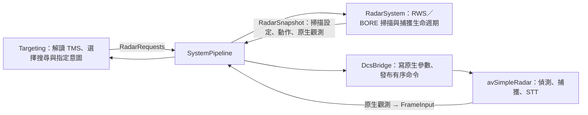

# 空對空雷達模式與參數依據

更新：2026-11-20。本輪選擇 CRM／RWS 與 ACM／BORE，捕獲後使用 avSimpleRadar 原生 STT。
參考方向為 F-16C Block 25。使用者已同意：公開數值不足時，保留專案既有探測性能，
掃描參數採有明確來源與適用差異的 F-16 原廠參考資料。

## 實作與操作

| 情境 | 生效功能 | 操作 |
|---|---|---|
| A-A（2）、MSL OVRD（右 Alt＋D） | CRM／RWS，寬區搜尋 | 按住右 Alt＋I／K／J／L 移動游標；按下再放開 TMS 上（I）捕獲游標附近目標 |
| DGFT（右 Ctrl＋D） | ACM／BORE，機鼻前方窄區 | 按下再放開 TMS 上（I）啟動連續自動捕獲；之後將機鼻對準目標 |
| 任一空對空配置 | 原生 STT | 以 Radar Observed＝STT 為鎖定成功；TMS 下（K）拒絕目標／停止自動捕獲 |
| NAV（1）／A-G 空殼 | 退出本輪搜尋配置 | 結束舊捕獲操作；A-G 的既有入口維持預留 |

進入 DGFT 先配置 BORE，捕獲由明確的 TMS 操作啟動。BORE 會保持捕獲要求，
直到找到目標或飛行員取消；成功後結束捕獲輸入，持續使用原生 STT 回報。
失鎖且仍啟用自動捕獲時，在原生回到 SEARCH 後重新捕獲。

CRM 的 Spotlight、TWS、目標資料展開／優先序，以及 ACM 的 30×20／10×60 等入口回報 Reserved。
它們保留現有的已支援掃描配置。DGFT 的 TMS 下停止捕獲並保留 BORE；TMS 右保留 WideScan 要求入口。
TWS 要求與真正執行的 RWS 分別顯示。SAM 與多目標航跡保留入口。前視捕獲框與右下角雷達圖見 [雷達顯示](RADAR_DISPLAY.zh-TW.md)。

## 參數與來源

設定集中於 `Core/Systems/RadarSystem/Internal/SearchProfiles.h`；原生載入設定位於
`Cockpit/Scripts/RADAR/FCK1C_Radar.lua`。角度為全寬，距離為公尺。

| 項目 | 本輪設定 | 依據與適用差異 |
|---|---|---|
| 原生探測模型最大距離 | 90,000 m | 沿用專案既有校準；需要搭配 DCS 原生 RCS／偵測模型解讀，未宣稱為 GD-53 對戰機實測距離 |
| 原生 STT 角限 | 方位 ±70°、仰角 ±45° | 沿用既有載入設定 |
| RWS 水平搜尋 | ±60°，全寬 120° | Westinghouse 原作者 1984 論文表 1 的 APG-66 寬掃描參考值；該表屬較早 F-16 雷達，屬本輪借用，並非 Block 25／GD-53 的專屬證據 |
| RWS 垂直搜尋 | 18.4°，原生每條帶 4.6° | 四條帶取早期 F-16 參考配置；以 MLU BORE 仰角波束高度映射原生 `scan_beam`，是工程近似。實際 F-16 條帶重疊、掃描時間需另外校準 |
| RWS 顯示參考量程 | 40 NM（74,080 m） | 16PR14341 圖 3-2 的顯示參考選擇；獨立於 90 km 探測模型與 STT 限制 |
| BORE 角窗 | 3.3° × 4.6° | Lockheed Martin 16PR14341，1998 F-16 A/B MLU，印刷頁 134–135／PDF 144–145；機型／年代不同，採為本輪參考 |
| BORE 中心 | 機體參考視線 0°／0° | 本專案 LOS 對齊設定；HUD 圖面偏移與天線機體角度分開處理 |
| BORE 捕獲上限 | 10 NM（18,520 m） | 手冊印刷頁 126 的 ACM 5／10 NM 量程供工程選擇；本專案明確選 10 NM 作捕獲門，並非已證實的 GD-53／Block 25 捕獲性能 |
| RWS 捕獲距離窗 | 6,000 m | 原生介面既有參考；全／半窗語意待 DCS 校準 |
| BORE 捕獲距離窗 | TDC 中心 5 NM，窗口設定 20 NM | 覆蓋 0–10 NM 的原生窗口設定；最大搜尋距離另裁切為 10 NM，窗口邊界待 DCS 校準 |
| 供電、掃描速度與地物設定 | 沿用既有載入值 | 供電持續開啟；本輪不處理冷啟動與備援 |

BORE 設定為隨機體視線，RWS 保留姿態穩定與原生天線俯仰操作。RWS 按住游標鍵時寫入 TDC，放開後使用原生回報；尚無有效原生 TDC 時初始化中央半量程。
BORE 在捕獲階段固定 TDC 與距離門；進入 STT 後停止覆寫 TDC，搜尋距離裁切恢復既有 90 km 校準。
因此已鎖目標超過 BORE 捕獲距離或離開原角窗時，仍交原生 STT 追蹤判定。

以上數值有來源、借用與工程映射三種性質；它們共同構成本輪可測試配置，尚未構成現役 GD-53／早期 Block 25 的完整性能模型。

## 職責與資料流

RadarSystem 發布具型別的 `RadarScanControl`；既有 CockpitSnapshotExporter 先寫原生參數，
再發布含捕獲命令的 MC 傳送視窗。Lua 保留原生設備載入、供電與既有命令轉接。
設備參數寫入失敗沿用 CockpitParameterEndpoint 的錯誤／恢復紀錄。

RWS／BORE 操作回報 Simplified，表示採原生通用雷達配合軟體掃描配置；鎖定成功仍由來源觀測判定。
509 用於 SEARCH 開始捕獲，也用於 STT 返回搜尋；510 結束尚未完成的捕獲輸入。
這輪採已查核的 509／510，移除捕獲時附帶的 100／1627 換鎖操作；重複捕獲會保留既有 STT。

## 診斷與驗證

正常 debug 通道新增：

- `mc_radar_active`：真正執行的 CRM RWS／ACM BORE／IDLE。
- `mc_radar_scan`：要求的掃描全寬／全高與搜尋距離門。
- `mc_radar_acquisition`：自動捕獲啟用／待操作。

這些欄位描述本專案要求及流程；`mc_radar_observed` 的原生 SEARCH／LOCK ATTEMPT／STT 才是感測器回報。
RWS 在原生調整天線後的實際掃描中心，與要求配置的初始中心分開解讀。

必要 DCS 驗證情境：

1. **2** 進 A-A；以 **右 Alt＋I／K／J／L** 將游標移到回波，按下再放開 **I**；核對 SEARCH → LOCK ATTEMPT → STT。
2. **K** 退出 STT，核對回 SEARCH；再捕獲一次，驗證命令生命週期。
3. **右 Ctrl＋D** 進 DGFT；先核對 ACM BORE、Auto Capture＝IDLE；按下再放開 **I** 後為 ENABLED。
4. 目標在 BORE 窗外／超過 10 NM 時保持等待；目標進入窗內且距離門內時自動捕獲。
5. STT 後重按 **I**，確認保留鎖定；目標離開 BORE 角窗或超過 10 NM 時，依原生 STT 追蹤能力持續回報。
6. 按 **K** 停止自動捕獲；**1** 回 NAV，確認捕獲結束。主保險 SAFE／SIM／ON 都可進行目標操作。
7. 重新測試 AIM-9 投放、DGFT 機砲與既有 CMS 程序，確認操作職責分離。

## 公開來源

- [中科院：經國號高性能戰鬥機](https://www.ncsist.org.tw/csistdup/products/product.aspx?catalog=55&product_Id=18)：GD-53 型號依據。
- [漢翔：翔昇機構改案交機，2018-10-18](https://www.aidc.com.tw/tw/news/344)：性能提升包含雷達電子反反制；未提供上述完整數值。
- [美國政府 Federal Register，2008-06-05，第 31990 頁](https://www.govinfo.gov/content/pkg/FR-2008-06-05/pdf/FR-2008-06-05.pdf)：當時 Block 25 的 APG-68(V)1 與後期 (V)9 升級的區別。
- [Kuchinski／Patton（Westinghouse），1984，AIAA 84-2609](https://doi.org/10.2514/6.1984-2609)：*The APG-66 radar and its derivative applications*；表 1 是 APG-66 參數。[NASA 書目](https://ntrs.nasa.gov/api/citations/19850015371/downloads/19850015371.pdf)可核對作者與題名；本輪參數借用依公開原稿轉錄，未取得出版 PDF 圖表校驗。
- [Lockheed Martin 16PR14341，1998 MLU Pilot's Guide](https://www.airwar.ru/other/manuals/%5Baviation%5D%20-%20%5Bmanuals%5D%20-%20F-16A-B%20MLU%20Pilot%20Guide%20Part%201.pdf)：印刷頁 125–126、133–135，模式與 BORE 參考值。
- [avSimpleRadar 介面調查](AVSIMPLE_RADAR_API_RESEARCH.zh-TW.md)：原生參數、509／510 分支、來源與 DLL 版本。
