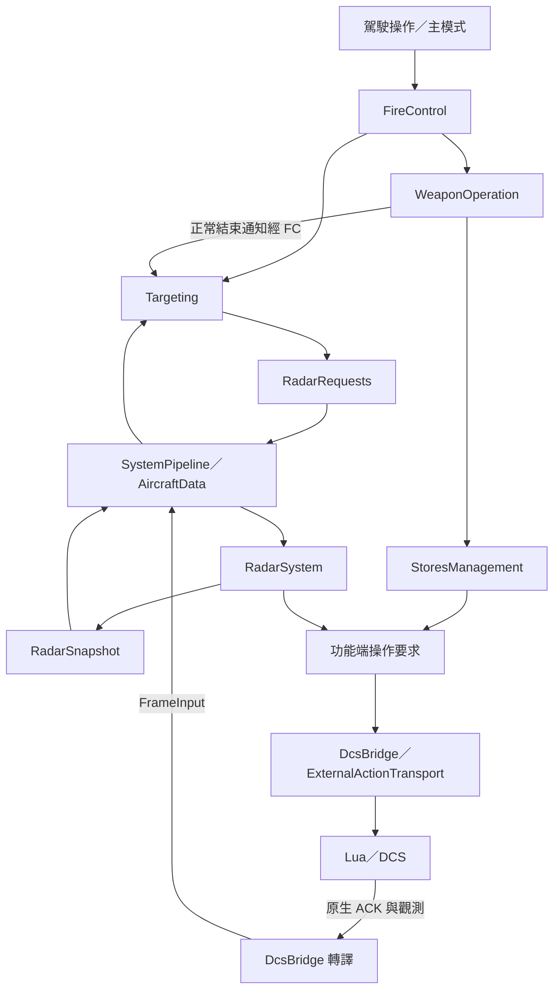

# Targeting、RadarSystem 與 DCS 動作傳輸

此文件說明跨 System 傳輸。SOI／TMS 操作以 [感測器操作](MC_SENSOR_CONTROLS.zh-TW.md) 為準，依 1997 年真機手冊建立入口及設備實作程度。

## 職責

| 擁有者 | 內容 |
|---|---|
| DisplaySystem | 模式固定的 MFD 功能與控制來源對應，經 Pipeline 發布 |
| MC／SensorOfInterest | SOI 來源與顯示位置、DMS 上下 |
| MC／FireControl | 組裝與分派；將武器正常結束結果通知 Targeting |
| MC／Targeting | TMS 與目標操作策略、捕獲方式、指定／切換／取消意圖 |
| RadarSystem | 設備操作、來源觀測、捕獲輸入確認及保持／放開 |
| SM | 掛載、選站、武器執行、取消與停止政策 |
| DcsBridge | 共用 DCS 傳送序號、視窗、確認與生產端編號對應 |
| Lua／DCS | 呼叫原生操作、提供觀測與執行確認 |

## 資料流

TargetingData 保存期望捕獲方式及目標意圖；RadarSnapshot 保存雷達來源觀測、介面可用性與要求結果。
目標指定、來源追蹤結果、IR 尋標器觀測各自維持原有權威。

## 三種編號

1. **MC 操作要求編號**：MC 的 ExternalActionOutbox 為 SM／CMS 動作及雷達要求保留共同來源順序。SM 以該編號追蹤自己的動作。
2. **RadarSystem 動作編號**：RadarSystem 保存設備動作序列；每組初始動作標明對應的 MC 雷達要求。
3. **DCS 傳送編號**：DcsBridge 合併上述輸出後配置連續序號。Lua 只處理此序號，保持原 16 項視窗與成功前綴 ACK。

DcsBridge 將 DCS ACK 對應回 MC／RadarSystem 的完整要求前綴，再隨 FrameInput 交給 Pipeline。部分設備動作完成時，MC 的雷達要求要等整組動作完成才確認。

## 排序與撤回

MC 的雷達要求在共同來源順序中保留佔位。DcsBridge 等待對應 RadarSystem 結果後展開設備動作，再處理後續 MC 操作。因此模式配合仍先於其後的投放。

RadarSystem 週期產生的捕獲放開動作，在同輪 MC 操作之後接續；來源自身的動作序號保持連續。
SM 撤回未完成啟動或選站時，來源要求與已排入傳送的對應項目更新為空操作，原序號繼續完成確認。必要停止仍由 SM 安排。

ExternalActionOutbox 保存功能要求及結果；ExternalActionTransport 擁有實際 DCS 傳送佇列與視窗。RadarRequestQueue 僅提供 Targeting 的具型別入口。

## 保留的行為

- 主保險與一般 NAV／A-A／A-G、DGFT／MSL 超控獨立；SAFE／SIM 保留目標指定。
- TMS 依 SOI 分派，CRM 上向在放開時提出捕獲；ACM 依手冊選 BORE、30×20、10×60。
- TMS 左展開資料、右輪選優先目標／長按 TWS 與空地要求，經設備結果明確標示預留功能。
- 武器使用資格、SM 選站／停止／取消、至少 80 ms 的保持及反制程序維持原分工。
- 既有 DCS 動作與座艙參數維持對應；TMS／DMS 採新的預設鍵，新增 boresight 語意操作。

## 驗證與產物

本輪以實際 SystemPipeline、MC、RadarSystem 及 DcsBridge 傳送器執行回歸，涵蓋跨 tick 保留、多次操作順序、部分 ACK、撤回、來源失效、捕獲保持與模式／保險獨立。

Linux 回歸與固定 Windows 工具鏈驗證結果分列如下。bin 的 DLL 採用下列已核對來源的 CI 產物；DCS 實機測試流程見 [MC 完整測試](MC_FLIGHT_TEST.zh-TW.md)。

### 本機驗證結果

| 檢查 | 結果 |
|---|---|
| 完整 Core 編譯與 MC／RadarSystem／SM／模式／Pipeline／正式入口回歸 | 1,186 項，0 失敗 |
| Bridge／Exporter／FrameInputCollector 相容回歸 | 517 項，0 失敗 |
| Lua 5.1.5 | 6,195 項，0 失敗 |
| 提交、排版及 CI 工具回歸 | 84 項通過，5 項 Windows 專用檢查待 Windows 執行 |
| 自有 C++ 排版 | 306 檔通過 |
| EFM 架構 | 266 個來源通過 |
| 座艙架構及 fixtures | 123 個自訂參數、16 個原生參數通過 |
| DCS ID／System catalog／架構產生器與規則 fixtures | 通過 |
| BridgeContext 與 EFM 回呼相容語法檢查 | 通過 |

Bridge 相容檢查只在暫存副本提供 Windows 模組查詢／路徑函式及 MSVC 宣告巨集的相容替身，生成表的字串常數宣告亦只在該副本適配 GCC。專案 SDK、第三方與產生器維持原版；固定 MSVC 工具鏈、DLL 載入與 DCS 遊戲驗證另行執行。

命令、參數名稱及數值與基準一致；子模式 VerticalScan=2、Hud=3 由實際 Exporter 回歸核對。變更中的參數目錄只更新共用傳輸項目的擁有者。

## Windows 驗證（2026-11-12）

- 驗證來源：`d0bb57ccda07ad9dce47c5983175ad79ee9754d0`。
- [完整 Windows CI](https://github.com/jjjjj103074/F-CK-1C/actions/runs/43195246543) 通過。
- DLL 專案明確編譯 ExternalActionTransport；來源、一般建置與分析重建使用相同內容。
- 固定工具鏈：MSVC `19.29.30159.0`、link `14.29.30159.0`、Windows SDK `10.0.26100.0`。
- 原生測試：**4,631 項，0 失敗**；完整驗證 **16 個步驟通過**，含靜態分析、DLL 雜湊、接口、載入／卸載、來源完整性與產生器測試。
- CI manifest 的 source commit、tree 與本機對應版本一致；下載 DLL、一般重建及分析重建的 SHA256 一致。
- `bin/F-CK-1C_EFM.dll` 更新為該驗證產物；SHA256：`05ecc0b6a0f14af83802fbc3a03a654f3e53b92227316d8c01441bc88cef72af`。
- DCS 遊戲驗證維持 `not_run`，由測試包的人工流程另行核對。

## RWS／BORE 設備設定

RadarSnapshot 的 RadarScanControl 隨 Pipeline 發布至既有 DcsBridge 匯出器。
RWS 保留原生 TDC 與天線俯仰操作，BORE 固定近距離捕獲窗口。
捕獲成功由原生 STT 回報確認；STT 時使用既有感測器距離校準與原生追蹤限制。

本輪使用已查核的 509／510 進行捕獲與釋放，取代附帶的 100／1627 換鎖操作。
其他外部動作仍沿用相同的來源編號、共用傳送視窗及確認規則。
參數依據與操作見 [雷達模式](RADAR_MODES.zh-TW.md)。
