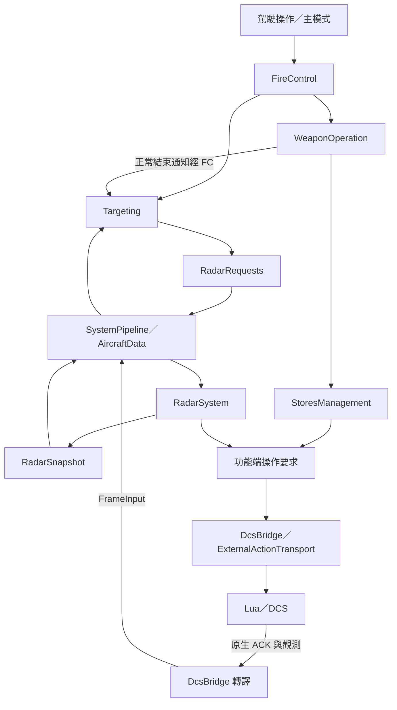

# Targeting、RadarSystem 與 DCS 動作傳輸

本輪基準：`f707d4a779f5a8818d19283470196ab76d967fbc`。本輪為職責重構，保留現有操縱與設備配合。

## 職責

| 擁有者 | 內容 |
|---|---|
| MC／FireControl | 組裝與分派；將武器正常結束結果通知 Targeting |
| MC／Targeting | TMS 與目標操作策略、捕獲方式、指定／切換／取消意圖 |
| RadarSystem | 設備操作、來源觀測、捕獲輸入確認及保持／放開 |
| SM | 掛載、選站、武器執行、取消與停止政策 |
| DcsBridge | 共用 DCS 傳送序號、視窗、確認與生產端編號對應 |
| Lua／DCS | 呼叫原生操作、提供觀測與執行確認 |

## 資料流

TargetingData 保存期望捕獲方式及目標意圖；RadarSnapshot 保存雷達來源觀測、介面可用性與要求結果。
目標指定、來源追蹤結果、IR 尋標器觀測各自維持原有權威。

## 三種編號

1. **MC 操作要求編號**：MC 的 ExternalActionOutbox 為 SM／CMS 動作及雷達要求保留共同來源順序。SM 以該編號追蹤自己的動作。
2. **RadarSystem 動作編號**：RadarSystem 保存設備動作序列；每組初始動作標明對應的 MC 雷達要求。
3. **DCS 傳送編號**：DcsBridge 合併上述輸出後配置連續序號。Lua 只處理此序號，保持原 16 項視窗與成功前綴 ACK。

DcsBridge 將 DCS ACK 對應回 MC／RadarSystem 的完整要求前綴，再隨 FrameInput 交給 Pipeline。部分設備動作完成時，MC 的雷達要求要等整組動作完成才確認。

## 排序與撤回

MC 的雷達要求在共同來源順序中保留佔位。DcsBridge 等待對應 RadarSystem 結果後展開設備動作，再處理後續 MC 操作。因此模式配合仍先於其後的投放。

RadarSystem 週期產生的捕獲放開動作，在同輪 MC 操作之後接續；來源自身的動作序號保持連續。
SM 撤回未完成啟動或選站時，來源要求與已排入傳送的對應項目更新為空操作，原序號繼續完成確認。必要停止仍由 SM 安排。

ExternalActionOutbox 保存功能要求及結果；ExternalActionTransport 擁有實際 DCS 傳送佇列與視窗。RadarRequestQueue 僅提供 Targeting 的具型別入口。

## 保留的行為

- 主保險與 NAV／DGFT／MSL 獨立；SAFE／SIM 保留目標指定。
- DGFT 進入的一次捕獲、TMS 脈衝／按住、解籠配合及投放結束取消指定維持原規則。
- Hud 保存捕獲選擇，TMS Left 維持空操作。
- 武器使用資格、SM 選站／停止／取消、至少 80 ms 的保持及反制程序維持原分工。
- DCS 動作值、按鍵與座艙參數名稱／數值維持既有對應。

## 驗證與產物

本輪以實際 SystemPipeline、MC、RadarSystem 及 DcsBridge 傳送器執行回歸，涵蓋跨 tick 保留、多次操作順序、部分 ACK、撤回、來源失效、捕獲保持與模式／保險獨立。

使用者指定先不 commit。本機環境為 Linux，固定 Windows 工具鏈及 DCS 遊戲驗證留待後續執行；bin 的 DLL 保持已提交版本，遊戲測試使用重建後的 DLL 與同版來源。

### 本機驗證結果

| 檢查 | 結果 |
|---|---|
| 完整 Core 編譯與 MC／RadarSystem／SM／模式／Pipeline／正式入口回歸 | 1,186 項，0 失敗 |
| Bridge／Exporter／FrameInputCollector 相容回歸 | 517 項，0 失敗 |
| Lua 5.1.5 | 6,195 項，0 失敗 |
| 提交、排版及 CI 工具回歸 | 84 項通過，5 項 Windows 專用檢查待 Windows 執行 |
| 自有 C++ 排版 | 306 檔通過 |
| EFM 架構 | 266 個來源通過 |
| 座艙架構及 fixtures | 123 個自訂參數、16 個原生參數通過 |
| DCS ID／System catalog／架構產生器與規則 fixtures | 通過 |
| BridgeContext 與 EFM 回呼相容語法檢查 | 通過 |

Bridge 相容檢查只在暫存副本提供 Windows 模組查詢／路徑函式及 MSVC 宣告巨集的相容替身，生成表的字串常數宣告亦只在該副本適配 GCC。專案 SDK、第三方與產生器維持原版；固定 MSVC 工具鏈、DLL 載入與 DCS 遊戲驗證另行執行。

命令、參數名稱及數值與基準一致；子模式 VerticalScan=2、Hud=3 由實際 Exporter 回歸核對。變更中的參數目錄只更新共用傳輸項目的擁有者。
