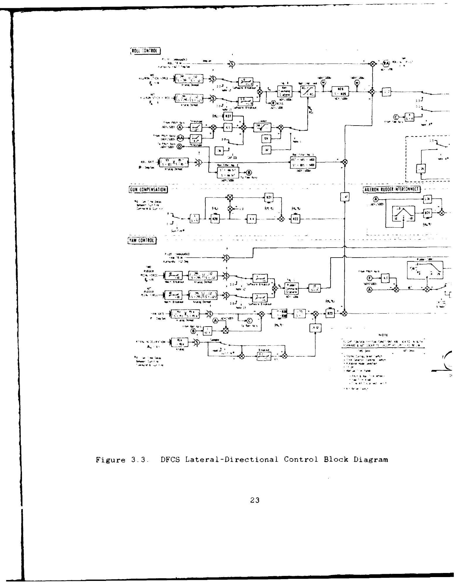
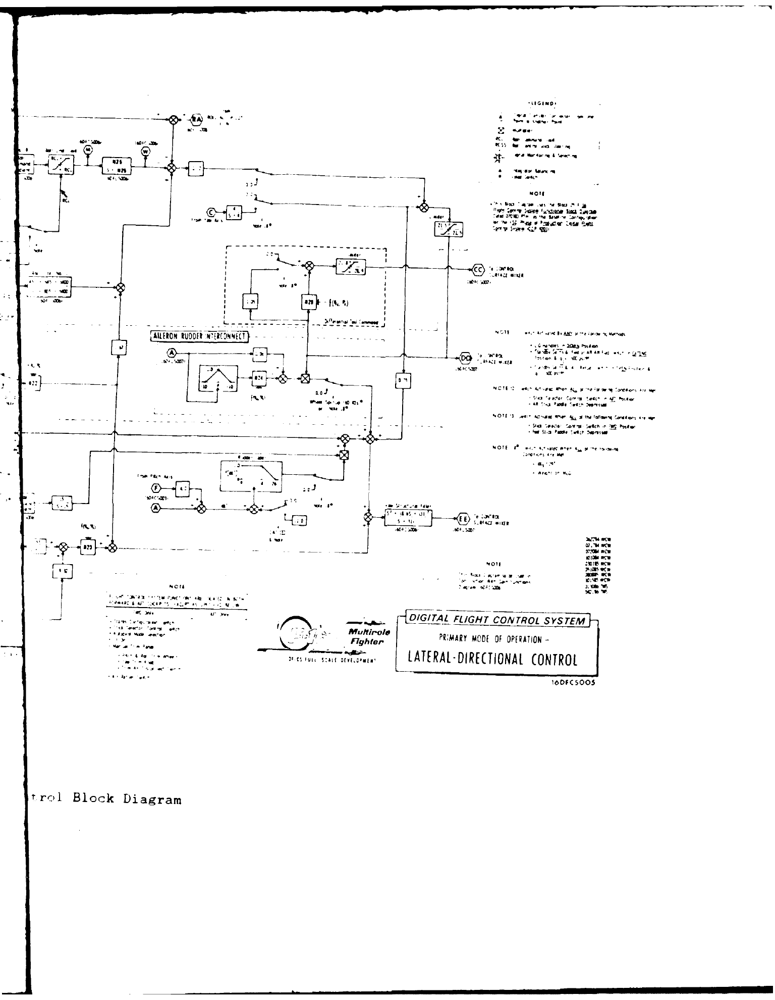
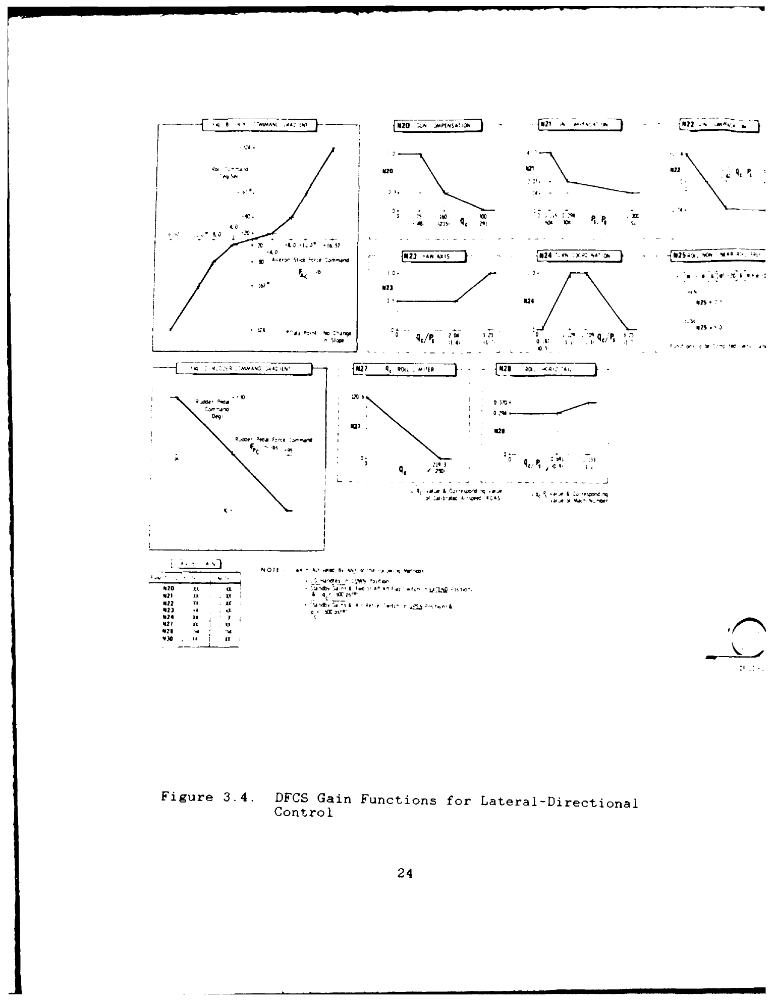
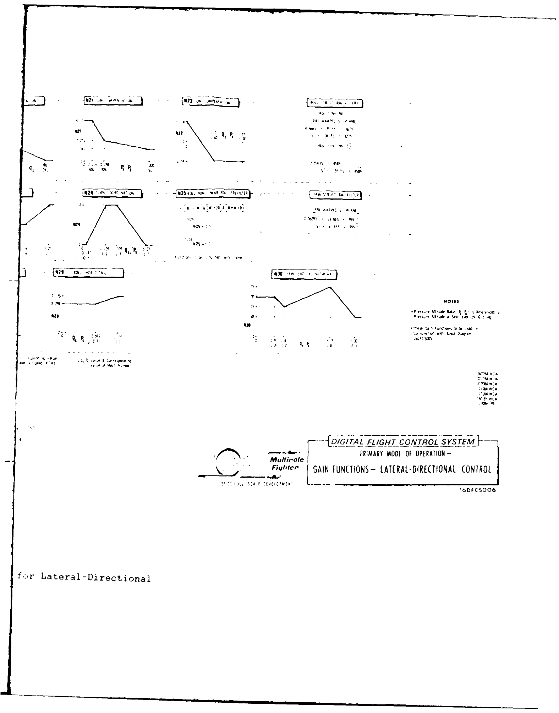
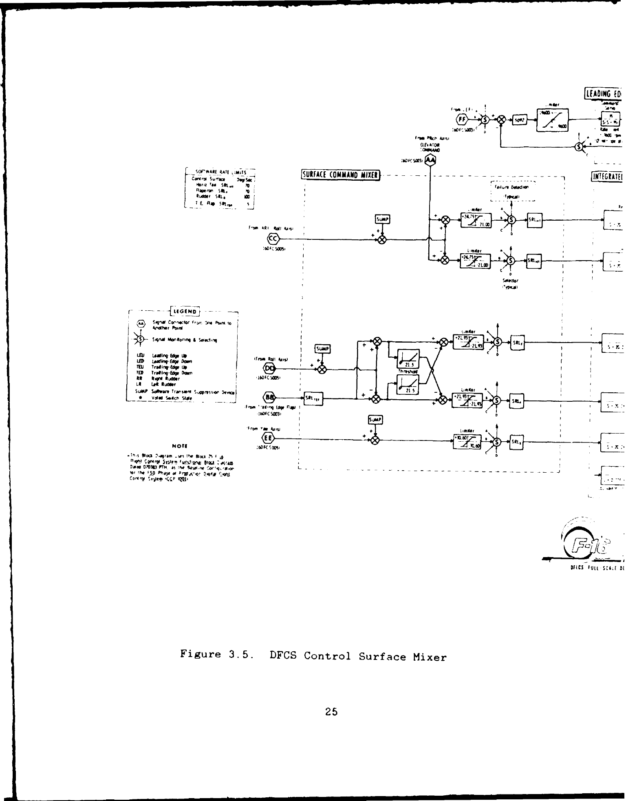
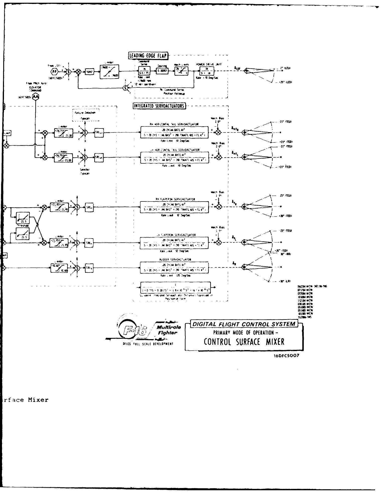

# SRC-000001: F-16 SIMTACS Thesis

Mark W. Kassan, *F-16 Simulator for Man-in-the-Loop Testing of Aircraft Control
Systems (SIMTACS)*, MS thesis, Air Force Institute of Technology (AFIT), December
1987. Report `AFIT/GE/ENG/87D-30`; DTIC accession `AD-A189675`.

- [Source record](source.yaml): bibliography, links, assessments, assets, rights.
- [Document guide](guide-v001.md): substantive chapter/appendix condensation.
- [Original PDF](document-v001.pdf): the unchanged, 186-page scan formerly at
  `research/references/ADA189675.pdf`.
- [Control-law knowledge](../../knowledge/control-law-design.md): fuller reference
  diagrams versus the thesis's deliberately simplified controller.
- [Simulation-validation knowledge](../../knowledge/flight-simulation-validation.md):
  test scope, timing limitations, and missing reproducibility inputs.

## Provenance and retrieval

The author is a USAF officer and the issuing institution is AFIT, not NASA.
NASA's [official bibliography record](https://ntrs.nasa.gov/citations/19880017779)
and its [bibliography PDF](https://ntrs.nasa.gov/api/citations/19880017779/downloads/19880017779.pdf)
contain the thesis listing `N88-21178` on printed p. 445. That publication is
NASA-SP-7037(229), not the thesis itself. Its NASA government-work designation
must not be transferred to every work it lists.

The [DTIC catalog](https://apps.dtic.mil/sti/citations/ADA189675) and
[DTIC PDF endpoint](https://apps.dtic.mil/sti/pdfs/ADA189675.pdf) returned HTTP 403
on 2026-10-24. Their known URLs remain in the source record. No fresh download
or byte-for-byte comparison with a NASA/DTIC copy is claimed. The existing
repository PDF was moved without changing its bytes; its original acquisition
date and download location are not established.

Publication is known to the month, December 1987 (PDF p. 5). `published_at` is
null because the current contract requires a complete date; the actual month
is retained in `publisher_revision` and here, not invented as December 1.
Bibliographic extent is not PDF pagination: NASA lists 176 pages, the report
form lists 175, and this exact scan contains 186 PDF pages. Covers, split
foldouts, and the second-volume microfiche front matter count in PDF locators.
Do not use one fixed printed-to-PDF page offset throughout this scan.

## Source-specific rights notice

The original PDF and its figure/table renders are not relicensed under the
repository's MIT or CC BY asset defaults. Preserve their source identity and
notices. The independently authored guide and knowledge prose follow the
project documentation license; that does not license embedded source images.

The recorded research-preservation assessment uses the author's USAF/AFIT
official-research context (PDF pp. 5, 184),
[17 USC sections 101/105](https://www.copyright.gov/title17/92chap1.html#105),
and [AFIT's government-work policy](https://scholar.afit.edu/etd/policies.html),
together with the explicit public-release/unlimited-distribution statements
on PDF pp. 4-5 and 184. It is a documented assessment of this use, not a newly
obtained worldwide license or a claim that NASA hosting makes a work unrestricted.
Distribution Statement A alone is not a copyright license.

Selected diagrams are limited research quotations accompanying the guide and
knowledge explanations, assessed separately under the actual research use and
[Taiwan Copyright Act articles 52, 64, and 65](https://law.moj.gov.tw/LawClass/LawAll.aspx?PCode=J0070017).
The source attributes the fuller DFCS diagrams to material supplied through the
F-16 System Program Office (reference 22, PDF p. 182). Their independent
authorship or unrestricted reuse has not been established. Do not present them
as newly licensed artwork, imply endorsement, or detach them for unrelated use.
Reassess rights if the material, use, jurisdiction, or relevant notices change.

## Saved figure and table pages

These are unchanged full-page Poppler renders at 180 dpi, not AI reconstructions.
The scan's original legibility limits remain; enlargement does not recover
missing labels. Read both halves of each split foldout.

| Asset | Original locator | Purpose |
|---|---|---|
| `FIG-001`, `FIG-002` | PDF pp. 40-41, Figure 3.1 | Fuller longitudinal DFCS reference, two scan halves |
| `FIG-003`, `FIG-004` | PDF pp. 42-43, Figure 3.2 | Fuller longitudinal gain-function reference, two scan halves |
| `FIG-009`, `FIG-010` | PDF pp. 44-45, Figure 3.3 | Fuller lateral-directional DFCS reference, two scan halves |
| `FIG-011`, `FIG-012` | PDF pp. 46-47, Figure 3.4 | Fuller lateral-directional gain-function reference, two scan halves |
| `FIG-013`, `FIG-014` | PDF pp. 48-49, Figure 3.5 | Fuller control-surface mixer, two scan halves |
| `FIG-005` | PDF p. 50, Table I | Fixed gains and the beginning of the simplification assumptions |
| `FIG-006` | PDF p. 51, Figure 3.6 | Thesis's simplified longitudinal controller |
| `FIG-007` | PDF p. 52, Figure 3.7 | Thesis's simplified lateral-directional controller |
| `FIG-008` | PDF p. 94, Table III | Mass properties and initial conditions of the response plots |

Use the asset inventory for paths, hashes, related knowledge, and action-specific
rights. Consult the original pages for other figures; this selection is not an
exhaustive list of useful content.

### Figures 3.3-3.5 paired-page review

The following pairs preserve every page of Figures 3.3-3.5 present in this scan,
in PDF order, including original overlap, captions, notes, and title blocks.
The two halves are complementary, not duplicate figures. No labels or missing
connections have been reconstructed; some fine print remains unclear in the
original. The source-specific research-quotation assessment above applies.

#### Figure 3.3: DFCS lateral-directional control

SRC-000001 / v001 / PDF-001, PDF pp. 44-45; FIG-009 then FIG-010.

#### Figure 3.4: Lateral-directional gain functions

SRC-000001 / v001 / PDF-001, PDF pp. 46-47; FIG-011 then FIG-012.

#### Figure 3.5: Control-surface mixer

SRC-000001 / v001 / PDF-001, PDF pp. 48-49; FIG-013 then FIG-014.

