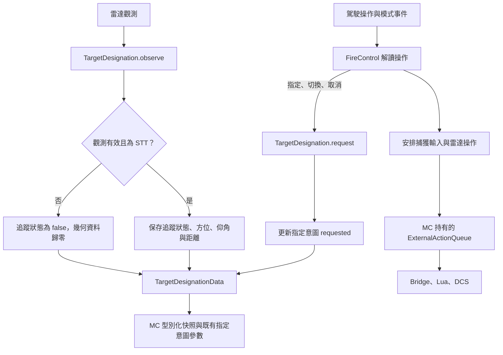
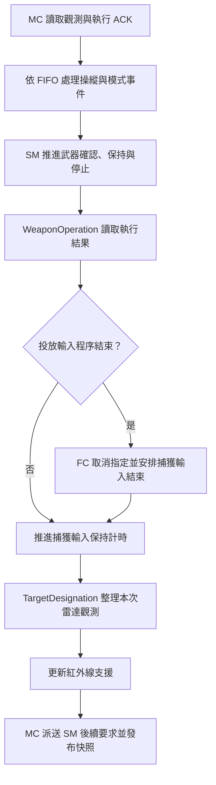
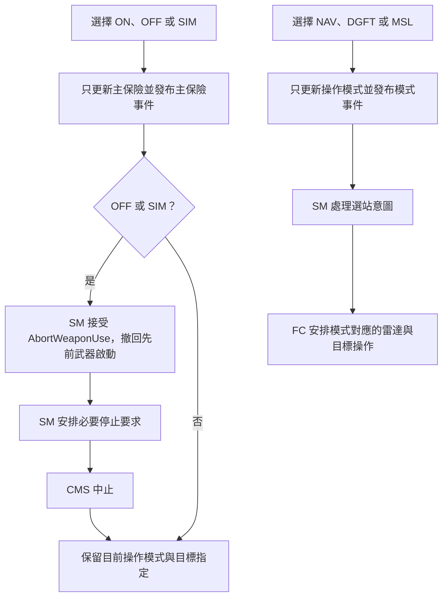
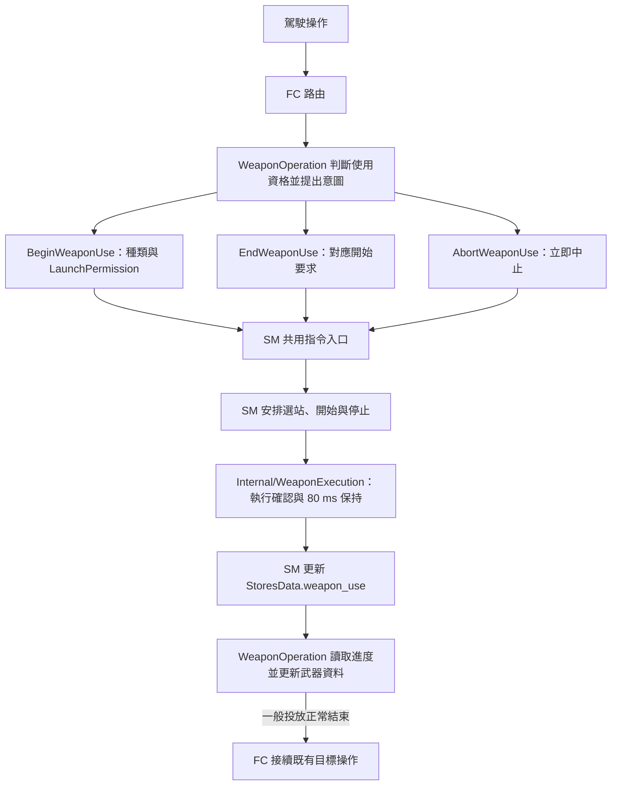

# FireControl、目標指定與武器使用

更新：2026-11-11。這是本專案的職責安排，沿用 MC 的 32 Hz 與共用動作傳輸。
本輪基準：`8ce0a591ce818af73526bf3a921c19dacf403334`。

## 分工與資料

| 位置 | 職責 | 主要資料 |
|---|---|---|
| FireControl.cpp | 組裝、模式事件、武器程序結果與更新順序 | ModeData、FireControlData |
| FireControlTargetInput.cpp | 同一 FireControl 類別的 TMS 解讀、雷達操作及捕獲輸入計時 | acquisition_mode、私有 acquisition_input_ |
| Internal/TargetDesignation | 接受指定／切換／取消意圖，整理雷達追蹤觀測 | target_designation，唯一寫入 |
| Internal/WeaponOperation | 解籠、使用資格、開始／結束意圖及執行結果整理 | weapon，唯一寫入；StoresData.weapon_use 唯讀 |
| Internal/InfraredMissileSupport | 整理既有尋標接觸、鎖定與音調要求 | infrared_missile，唯一寫入 |
| StoresManagement | 掛載、選站、武器執行確認、輸入保持與停止 | StoresData，含 weapon_use |

TargetDesignation 只持有 TargetDesignationData 的參照，提供 request 與 observe 兩個介面。
FC 是目標操作的單一協調入口；模式、按鍵、保險、掛載條件與操作計時各由表中責任位置處理。
FireControlTargetInput.cpp 是既有 FC 的實作分檔。MC 仍有八個同層元件，DFLCC 維持原有架構。
WeaponOperation 回傳 ReleaseInputEnded 後，由 FC 安排原有的投放結束取消指定流程。
紅外線支援讀取指定意圖與武器解籠狀態，沿用原型推導。WeaponOperation 依資格提出使用意圖，尋標資料由紅外線支援整理。

## 目標指定流程

requested 表示 FC 已接受的指定／切換意圖；取消要求將其設為 false。
radar_tracking 依有效雷達觀測的 SingleTargetTrack 模式更新。
指定意圖、雷達追蹤結果及飛彈尋標器鎖定各自保存；取消指定後，雷達欄位仍反映最近收到的觀測。
幾何資料使用弧度與公尺。目標觀測隨 FireControlSnapshot.target_designation 發布；
原有 AIM9 指定、解籠、音調與 HMCS 參數沿用既有映射。

## FC 操作與更新

TMS 與模式進入維持既有單次捕獲操作；每秒自動重送已移除。
脈衝／按住捕獲由 FC 的 AcquisitionInput 明確表達，80 ms 最短保持從 MC 首次收到執行確認的時間起算。
此保持策略屬本專案既有操作安排；ACK 記錄轉接層完成呼叫，雷達觀測記錄實際追蹤結果。
捕獲輸入結束保留指定意圖；取消指定則清除意圖並安排輸入結束。
NAV、DGFT、MSL 的雷達操作對應維持原有安排，Hud 保存操作選擇，TMS Left 沿用既有處理。

## 主保險與模式

保險操作保留目前模式，模式操作保留目前保險。ON 更新武裝資格，OFF／SIM 維持立即停止與 CMS 中止順序。
AbortWeaponUse 經 SM 單一入口接受，安排撤回與必要停止；後續新要求仍依 FIFO 處理。
NAV 與 CancelStoresCommands 沿用完整的選站及啟動取消規則。

## 武器使用流程

WeaponOperation 只持有唯讀 ModeData、唯讀 WeaponUseData、自己的 WeaponOperationData 與共用 SM 入口。
機砲與投放資格分別由 can_use_gun／can_release_weapon 表達；沿用原有主保險、模式與解籠條件。

投放超控由 WeaponOperation 明確選擇 LaunchPermission::Override，SM 依要求安排既有指令順序。
開始要求以 SM 指令編號識別；正常放開保留該編號，較早要求的回覆依編號對應自己的程序。
新的開始重設同種類的保持與放開意圖；新的拒絕保存在 rejected_request_id，原有已接受程序繼續保存。
機砲與投放各自追蹤，現有對外請求旗標及射擊指示維持原有映射。
MC 組裝處在入口通知時同步交由 SM 接受要求，供同一 FIFO 中後續放開讀取已接受的程序編號。

SM 將停止排入共用動作佇列後才寫入 StopScheduled；WeaponOperation 對同一正常投放結束通知 FC 一次。
Canceled 與正常結束分別保存；SAFE／SIM 中止保留目前目標指定。
撤回的開始仍由 SM 保存必要停止責任，正常放開依既有保持規則收尾，立即中止安排必要停止。
階段及 ACK 表達操作處理進度，實際離架與彈量變化由觀測更新。

## 本輪驗證

| 檢查 | 結果 |
|---|---|
| C++ MC／模式／SM／原生讀取回歸 | 903 項，0 失敗 |
| Lua 5.1.5 MC 介面與 HMCS 回歸 | 6,183 項，0 失敗 |
| C++ 排版 | 298 個檔案通過 |
| EFM 架構 | 260 個正式來源通過 |
| 座艙架構 | 126 個自訂參數、17 個原生參數通過 |
| code-review：Standards | 0 findings |
| code-review：Spec | 0 findings |

新增回歸覆蓋指定意圖與雷達觀測獨立、STT 有效性與幾何資料、OFF／SIM 加空載仍可捕獲、
保險切換保留目標及選站、模式保留保險、解籠持續三秒僅保留一次捕獲、
捕獲 ACK／保持時間，以及武器撤回保留選站、來源等待與後續新要求。
本輪新增回歸覆蓋開始 ACK 的觀測時間、80 ms 邊界、重按與舊結束要求、取消後新程序、
不可用時拒絕與恢復後新操作、雙程序獨立進度、取消後必要停止及停止先於 CMS／目標接續。
GCC 使用 C++17、Wall／Wextra／Werror，保留既有聚合初始化例外。
座艙架構檢查在暫存控制器中使用平台路徑分隔符；專案檢查腳本維持原版。

前輪目標指定整理已提交為 `8ce0a59`，當時兩軸 code-review 各為 0 findings。
本輪武器使用整理完成兩軸 code-review 後提交至本機，尚未 push。
bin 的 DLL 保留前次 Windows 產物，待後續重建。
固定 Windows 工具鏈建置／分析與 DCS 遊戲驗證待後續 DLL 重建時執行。
