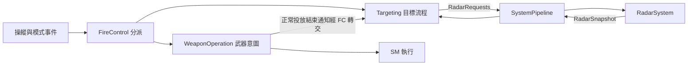

# FireControl 與 Targeting

FireControl 組裝 Targeting 與 WeaponOperation，分派操作及程序結果。MC 依 SOI 將 FCR 的 TMS 操作送進火控。目標取得策略由 Targeting 擁有，雷達設備操作由 [RadarSystem](../../../RadarSystem/README.md) 經 SystemPipeline 執行。

| 位置 | 職責與主要依賴 |
|---|---|
| FireControl | 操作分派、主模式通知、武器正常結束通知及更新順序 |
| Internal/Targeting | 唯讀 ModeData／RadarSnapshot；寫入 TargetingData；透過 RadarRequestQueue 提出雷達任務 |
| Internal/WeaponOperation | 使用資格、解籠及開始／結束意圖；唯讀 WeaponUseData；使用 SM 指令入口 |
| RadarSystem | 設備要求展開、捕獲輸入 ACK／保持／放開、雷達觀測與操作結果 |
| DcsBridge/ExternalActionTransport | 共用 DCS 序號、16 項傳送視窗及執行確認對應 |

`FireControlTargetInput.cpp` 與 TargetDesignation 類別已移除。TMS、解籠的目標配合、一般 A-A 與 DGFT／MSL 超控的捕獲策略及投放正常結束的取消指定規則，由 Targeting 完整管理。

## 目標與武器操作

主保險 OFF／SIM 由 WeaponOperation／SM 停止武器操作；Targeting 使用操作模式及雷達回報。
模式切換保留保險，並由 WeaponOperation 結束先前配置的武器使用。MSL STEP 的短按送出同型輪站意圖，按住達 0.5 秒送出一次換型意圖；SM 決定實際掛點。超控切換規則及座艙指令見[模式架構](../../../../../../../../docs/MC_MODE_EVENTS.md)。

TargetingData 保存期望的捕獲方式與指定意圖。雷達設備來源的工作模式、幾何及有效性由 RadarSystem 發布，再由 Targeting 整理成目前的目標資料。指定意圖與 STT 觀測各自保存。

解籠切換由 WeaponOperation 保存選擇狀態，FC 將更新後的選擇交給 Targeting 接續雷達要求。
DCS 輸入按一次切換，放開後保存；明確設定介面使用相同狀態。TMS 依 1997 年手冊處理 CRM／ACM 操作與右向 1 秒長按；設備能力由 RadarSystem 回報。投放前重送模式與投放結束取消指定維持既有分工。

操作表、來源與預留功能見 [感測器操作](../../../../../../../../docs/MC_SENSOR_CONTROLS.zh-TW.md)。

## 相關說明

- [跨 System 架構、序號與驗證](../../../../../../../../docs/RADAR_TARGETING_ARCHITECTURE.zh-TW.md)
- [MC 組裝](../../README.md)
- [先前 IR 觀測整理](../../../../../../../../docs/IR_OBSERVATION_REFACTOR_REPORT.zh-TW.md)
