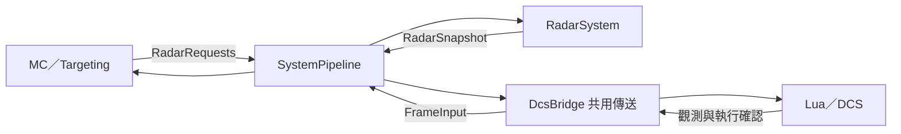

# RadarSystem

RadarSystem 與 MissionComputer 並列，由 SystemPipeline 以 32 Hz 執行。它讀取 MC 發布的 RadarRequests，推進設備操作，並發布 RadarSnapshot。

## 介面與資料

- 輸入：FrameInput 的原生雷達觀測、介面可用性及 DcsBridge 轉回的生產端執行確認；RadarRequests 的未完成要求。
- 輸出：RadarSnapshot，包含來源觀測、期望捕獲方式、要求接受結果及設備動作。
- 每筆要求依來源編號執行一次；完成紀錄保留至 MC 發布已完成前綴。
- 期望捕獲方式與來源 RadarMode 分別保存。座艙既有雷達開啟來源仍固定回報開啟。

Targeting 決定使用何種捕獲方式與指定／切換／取消。RadarSystem 展開設備操作，管理捕獲輸入生命週期。捕獲至少 80 ms 的保持從首次觀測到 DcsBridge 執行確認的 input_time 起算，補跑沿用當前觀測時間。

DCS 感測沿用 avSimpleRadar。ModeCannon、ModeFI0 等既有原生航電配合，透過語意動作維持相同映射；此處的期望捕獲方式屬本專案的運用介面。

## 通訊

System 間以 AircraftData 的具型別快照交換資料。兩個 System 在同一排程時間讀取同一份已提交快照；新要求於後續 tick 處理。

完整排序及確認規則見 [架構說明](../../../../../../docs/RADAR_TARGETING_ARCHITECTURE.zh-TW.md)。
